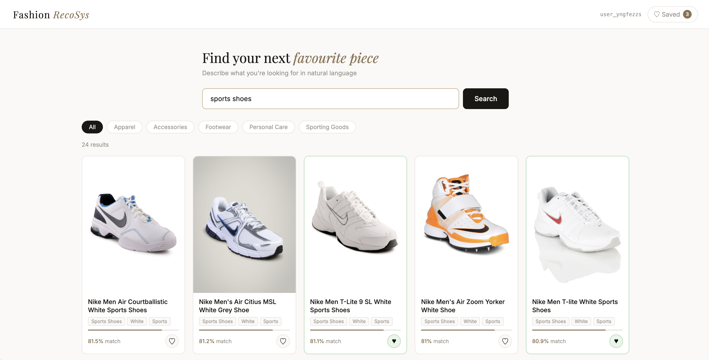
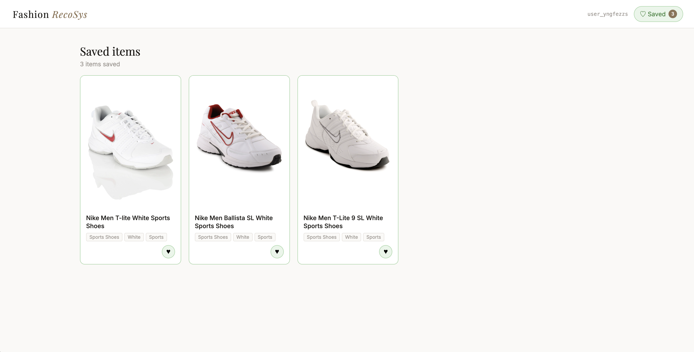

# 👗 Fashion RecoSys

> End-to-end semantic search and recommendation microservice powered by dense embeddings, FAISS vector indexing, and FastAPI.


---

## Screenshots




## Overview

Users query the catalog using natural language. The service encodes the query into a **384-dimensional dense vector**, performs cosine similarity search across **44,417 fashion products** via FAISS in under **5ms**, and returns ranked recommendations with product imagery.

User favorites and search history are persisted in SQLite by `user_id`, maintaining state across sessions.

---

## Architecture

```text
query (natural language)
        │
        ▼
  encode()  ──  sentence-transformers (all-MiniLM-L6-v2)
        │               384-dim dense vector
        ▼
  FAISS index  ──  IndexFlatIP (cosine similarity)
        │               44,417 indexed vectors
        ▼
  top-K products ranked by similarity score
        │
        ▼
  FastAPI  ──  JSON response + image URLs
        │
        ▼
  Frontend (HTML/JS)  ──  product grid + SQLite persistence
```

---

## Tech Stack

| Layer | Technology | Rationale |
|-------|-----------|-----------|
| **Embeddings** | `sentence-transformers` (`all-MiniLM-L6-v2`) | Lightweight (80MB), 384d output, fast CPU inference (~11s to encode 44k items) |
| **Vector Search** | FAISS (`IndexFlatIP`) | Exact inner-product search with sub-5ms query latency for catalogs under 1M items |
| **API Serving** | FastAPI + Uvicorn | Native async support, automatic OpenAPI docs, Pydantic validation |
| **Persistence** | SQLite | Zero-overhead relational storage for user favorites and query logs |
| **Frontend** | Vanilla HTML/CSS/JS | Dependency-free UI for direct inspection and low overhead |

---

## Dataset & Feature Engineering

Built on the **Fashion Product Images Dataset** (Kaggle), containing **44,417 products** with structured metadata and hosted image URLs.

| Column | Description |
|--------|-------------|
| `id` | Unique product identifier |
| `productDisplayName` | Full product title including brand |
| `gender` | `Men`, `Women`, `Boys`, `Girls`, `Unisex` |
| `masterCategory` | `Apparel`, `Accessories`, `Footwear`, etc. |
| `articleType` | `Shirts`, `Jeans`, `Watches`, etc. |
| `baseColour` | Primary product color |
| `season` | `Summer`, `Fall`, `Winter`, `Spring` |
| `usage` | `Casual`, `Sports`, `Formal`, `Ethnic` |

To improve semantic recall beyond title-only matching, all metadata attributes are serialized into a single rich text representation (`texto_embedding`) prior to encoding:

```text
"Turtle Check Men Navy Blue Shirt Shirts Topwear Men Navy Blue Fall Casual"
```

---

## Running Locally

### 1. Clone the repository and install dependencies
```bash
git clone [https://github.com/kellyleticia/recsys-fashion](https://github.com/kellyleticia/recsys-fashion)
cd recsys-fashion
uv sync
```

### 2. Verify raw dataset
`styles.csv` and `images.csv` are included under `data/`.

### 3. Build data artifacts and FAISS index
```bash
python preparar_dados.py      # cleans raw CSVs → data/produtos.json
python gerar_embeddings.py    # generates vectors → data/embeddings.npy
python construir_indice.py    # builds FAISS index → data/index.faiss
```

### 4. Start the API server
```bash
uvicorn api.main:app --reload
```

### 5. Launch the client
Open `frontend/index.html` in your browser (or inspect interactive docs at `http://localhost:8000/docs`).

---

## API Endpoints

| Method | Endpoint | Description |
|--------|----------|-------------|
| `GET` | `/` | Health check and total indexed products |
| `POST` | `/recomendar` | Semantic product retrieval from natural language query |
| `GET` | `/salvos/{user_id}` | Retrieve saved items for a user |
| `POST` | `/salvos` | Toggle save/remove state for a product |
| `GET` | `/historico/{user_id}` | Retrieve user search history |

### Request Example
```bash
curl -X POST http://localhost:8000/recomendar \
  -H "Content-Type: application/json" \
  -d '{"query": "casual blue shirt for men", "top_k": 6}'
```

### Response Example
```json
{
  "query": "casual blue shirt for men",
  "resultados": [
    {
      "id": 15970,
      "productDisplayName": "Turtle Check Men Navy Blue Shirt",
      "baseColour": "Navy Blue",
      "articleType": "Shirts",
      "score": 0.742,
      "imagem": "[http://assets.myntassets.com/](http://assets.myntassets.com/)..."
    }
  ]
}
```

---

## Project Structure

```text
recsys-fashion/
├── api/
│   ├── __init__.py
│   ├── main.py           # FastAPI routes and inference pipeline
│   └── database.py       # SQLite persistence for favorites and history
├── data/
│   ├── styles.csv        # Raw product metadata
│   ├── images.csv        # Product image URLs
│   ├── produtos.json     # Processed catalog (generated locally)
│   ├── embeddings.npy    # 44,417 × 384 float32 matrix (generated locally)
│   └── index.faiss       # Vector search index (generated locally)
├── docs/
│   ├── busca.png         # Search interface screenshot
│   └── salvos.png        # Saved items screenshot
├── frontend/
│   └── index.html        # Client interface
├── notebooks/
│   └── analise.ipynb     # Exploratory data analysis
├── construir_indice.py
├── gerar_embeddings.py
├── preparar_dados.py
├── pyproject.toml
├── uv.lock
└── README.md
```

---

## Engineering Trade-offs

* **Dense Embeddings vs. Lexical Search (TF-IDF):** Lexical matching fails on vocabulary mismatches (e.g., querying `"navy top"` when the catalog entry uses `"Shirts Topwear Men Blue"`). Dense embeddings capture semantic proximity between `"top"` and `"Topwear"` in vector space.
* **FAISS vs. Brute-Force NumPy Scan:** Linear scan across 44k 384-dimensional vectors requires ~17M floating-point operations per query. FAISS reduces retrieval latency to **< 5ms**.
* **Exact Search (`IndexFlatIP`) vs. ANN Scaling:** `IndexFlatIP` guarantees 100% recall with negligible latency at 44k items. Scaling to multi-million-item production catalogs would require migrating to `IndexHNSWFlat` or `IndexIVFFlat` to trade a small fraction of recall for sub-linear search time.
* **SQLite vs. Production Vector/Relational Stores:** SQLite keeps local setup self-contained. In a production environment with concurrent writes and hybrid metadata filtering, the persistence and retrieval layers would migrate to **PostgreSQL with `pgvector`**, preserving the same FastAPI service contract.
